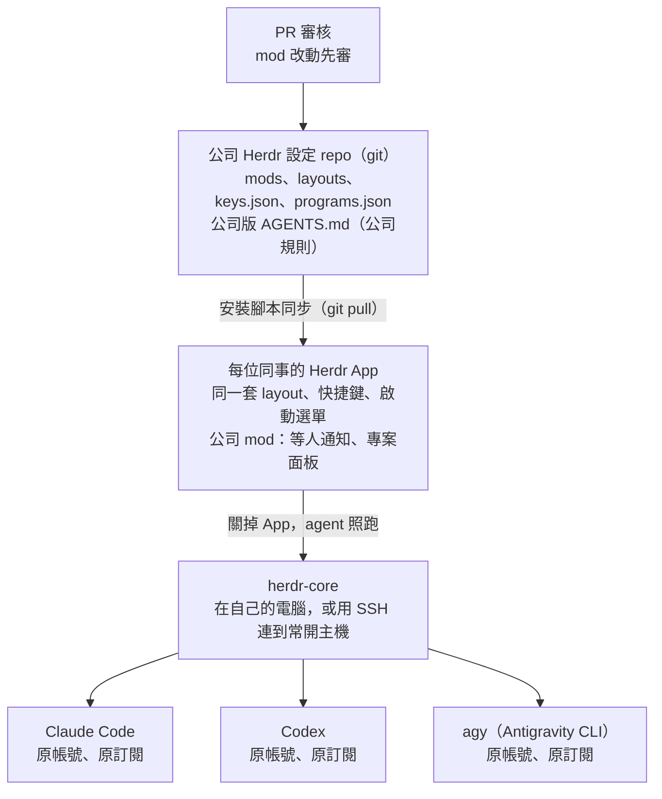
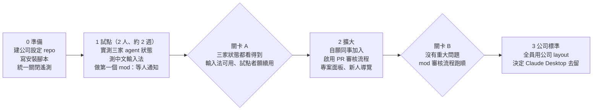

# 建議：全公司統一採用 Herdr App 作為 AI agent 工作台

> 給誰看：決定要不要試點的人。這是一份**導入評估**，不是操作教學。
> 想先搞懂 Herdr 是什麼：[[Herdr App 圖文入門指南]]（DevTools/）；指令與快捷鍵：[[tmux 與 herdr 指令、快捷鍵對照表]]。
> 相關架構思路：[[Multi-AI Agent 架構:1:1:1 對應、雙層部署、與 plugin 治理層]]（agent 放哪台機、plugin 統一規範）。
> 撰文日期：2026-11-16。文中版本號、試點人數與天數都是當時的建議值。

## 結論

建議把 Herdr App 當成全公司統一的 AI agent 工作台：Claude Code、Codex、agy 都在同一個視窗裡跑，公司再用自己的 mod 把內部流程接進來。

- **為什麼是現在**：Herdr App 在 2026-10-29 發表，免費、開源（Apache-2.0），支援 macOS、Windows、Linux；它的介面是一組設定檔，可以用 git 統一版本、發到每台電腦。
- **但不建議一次全換**：App 還在 0.1.x，而且它是給 CLI agent 用的，習慣 Claude Desktop 聊天介面的同事需要轉換。
- **建議做法**：先用 2 個人、約 2 週試點，驗證三家 agent 的狀態顯示和第一個公司 mod，再決定是否擴大。Claude Desktop 在試點期間照常使用。

（試點人數和天數是建議值，可以調整。）

## 現況：三套工具各自為政

公司現在同時用 Claude Desktop、Codex、agy（Google Antigravity CLI），每套工具有自己的視窗、設定和習慣。

| 問題 | 實際影響 |
| --- | --- |
| 視窗分散 | 要一個個切過去看，才知道哪個 agent 做完、哪個卡在等人 |
| 沒有公司標準 | 每個人的設定、快捷鍵、工作流程都不一樣，經驗很難共享 |
| 接不進內部流程 | 三套工具都無法在介面上加公司自己的面板或通知 |
| 工作綁在筆電上 | 闔上筆電或關掉視窗，長時間的任務就可能中斷 |

Herdr 不取代這些 agent，而是把它們的 CLI 版本收進同一個工作台；帳號、模型和訂閱都照舊。

## 提案架構

公司只維護一個設定 repo，每個人的 Herdr App 都從這裡同步；底下的 agent 還是各家原本的 CLI 和帳號。

> Claude Desktop 不在這套架構裡，可以繼續並存；Herdr 管的是各家 agent 的 CLI 版本。

Herdr 的支援清單裡已經有 Claude Code、Codex 和 Antigravity CLI。不過清單是 TUI 版的螢幕偵測，App 只認 OSC 7501 回報，所以三家在 App 裡能不能顯示狀態，要在試點第一週實測。

## 公司自己的 mod

Herdr App 的側邊欄、tab、快捷鍵、主題都是 `~/.config/herdr-app` 裡的純文字檔，mod 用 JavaScript 寫、改完即時重載；內建的側邊欄也是用同一套零件做的，所以公司 mod 能做到跟官方功能同等的事。

### 可以先做的 mod（構想）

| Mod | 做什麼 | 給誰 |
| --- | --- | --- |
| 等人通知 | agent 卡在 Blocked 時推播到公司的通訊工具（官方 guide 已有 ntfy 推播範例可參考） | 所有人 |
| 公司標準啟動選單 | ＋選單裡只放公司核准的 agent 和參數（`programs.json`） | 所有人 |
| 專案 / 客戶面板 | 在 agent 旁邊顯示目前專案的資料夾、交付日、規範連結 | 專案人員 |
| 用量面板 | 顯示各 agent 訂閱的剩餘額度（官網也舉過「方案剩多少」的例子） | 管理者 |
| 新人導覽 | 一個面板列出公司常用 prompt、規則、該用哪個 agent | 新同事 |

### 怎麼管理發佈

- 建一個公司內部的 git repo（例如 `company-herdr-config`），放 mods、layouts、`keys.json`、`programs.json`，和一份公司版 `AGENTS.md`（寫公司規則，讓 agent 改介面時也遵守）。
- 一支安裝腳本把 repo 同步到每個人的 `~/.config/herdr-app`，更新就是 `git pull`。
- 所有 mod 變更走 PR 審核，因為 mod 是未經沙箱的程式碼（見風險段）。
- 不要直接改官方附的 layout 和 mod，它們每次啟動都會被覆蓋；複製一份、加公司前綴再改。
- 個人想從公司版本再改自己的，可以，但想推廣給大家就發 PR 回公司 repo。

實際開發時，可以直接叫 Claude Code 讀 `AGENTS.md` 後寫 mod，再用 `herdr-app shot` 截圖讓它自己檢查結果。

## 風險與對策

最大的風險不是功能，而是「還很新」和「mod 是未受限的程式碼」，兩者都靠試點與審核控制。

| 風險 | 說明 | 對策 |
| --- | --- | --- |
| 軟體還在早期 | App 是 0.1.x，凍結、CPU、輸入法、剪貼簿等問題還在修 | 先試點；中文輸入法列為必測項目；試點期間保留舊工具 |
| agent 狀態顯示 | App 只認 OSC 7501 回報；agent 不支援就看不到狀態（仍可執行） | 試點第一週就驗 Claude Code、Codex、agy 三家 |
| Mod 沒有沙箱 | mod 可以執行程式、讀寫檔案、連網，還能在已連線的遠端機器上執行 | 只裝公司 repo 審核過的 mod；社群 mod 要先審過再收進 repo |
| core 沒有權限控制 | 碰得到 core socket 的人就能用你的帳號執行指令，沒有 API 密碼 | 每人只跑自己機器的 core；共用主機不要多人共用帳號 |
| 遙測預設開啟 | 每天回傳使用報告（不含終端文字、prompt、檔案內容） | 安裝腳本統一關閉（Settings → Privacy） |
| 非工程同事的門檻 | Herdr 是給 CLI agent 用的工作台，不是聊天介面 | 用公司 layout 和啟動選單降低門檻；不強迫，Claude Desktop 可以保留 |
| 重開機後不續跑 | 重開機後 Pane 會回來，但 agent 不會自動接回 | 長任務放在常開的主機上，用遠端機器功能連線 |
| 專案延續性 | 開發商是新創公司 | 全部 Apache-2.0 開源；公司 mod 只是設定檔，沒有被綁死 |

## 導入計畫

分四個階段，每過一個關卡才往下走；任何關卡沒過，就停在原本的工具，沒有損失。

試點是重點：第一週先確認三家 agent 在 App 裡的狀態顯示和中文輸入法，第二週做出「等人通知」這個最有感的 mod。各階段的日期等決定試點後再定。

## 需要決定的事

- [ ] 同意開始試點嗎？試點人選是誰（建議一位工程、一位非工程）？
- [ ] 公司通知要接哪個通訊工具？
- [ ] 公司 mod repo 放在哪裡、誰負責審核？
- [ ] 要不要準備一台常開主機給長任務用？
- [ ] Claude Desktop 是長期並存，還是試點成功後逐步淡出？

## 參考資料

- [Herdr 官網](https://herdr.dev/) · [下載](https://herdr.dev/download/) · [官方 Guide](https://herdr.dev/guide/) · [herdr-core](https://herdr.dev/core/)
- [Herdr 支援的 agent 清單](https://herdr.dev/docs/preview/agents/)
- [Falcão：Herdr Desktop 詳細評測](https://falcao.org/posts/herdr-desktop-finally-here/)
- [Moshi：TUI vs App vs herdr-core](https://getmoshi.app/articles/herdr-core-vs-tui)
- [Bitdoze：Layouts 與 Mods](https://www.bitdoze.com/herdr-app-layouts-mods/)
- [heise：Herdr desktop app 發表報導](https://www.heise.de/en/news/Herdr-desktop-app-A-hub-for-AI-coding-agents-11508175.html)
