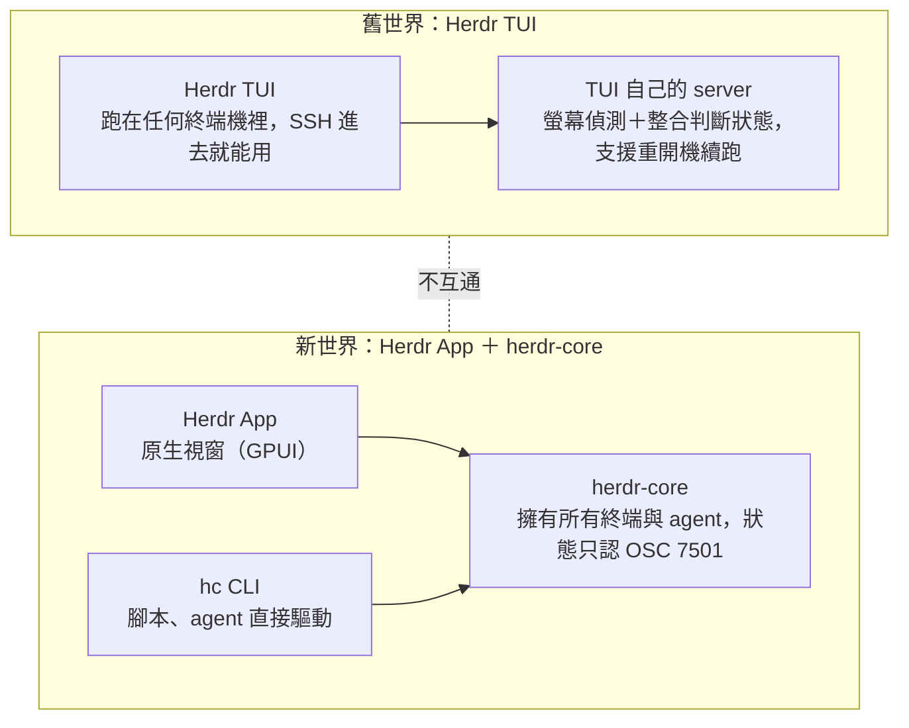
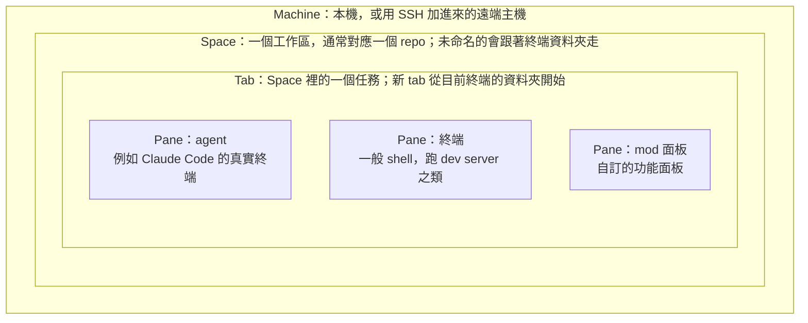
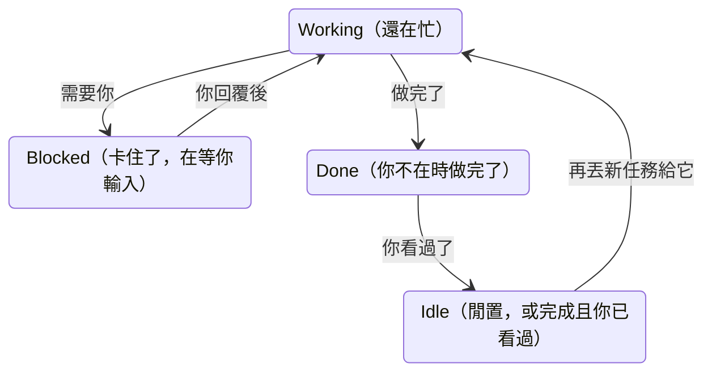
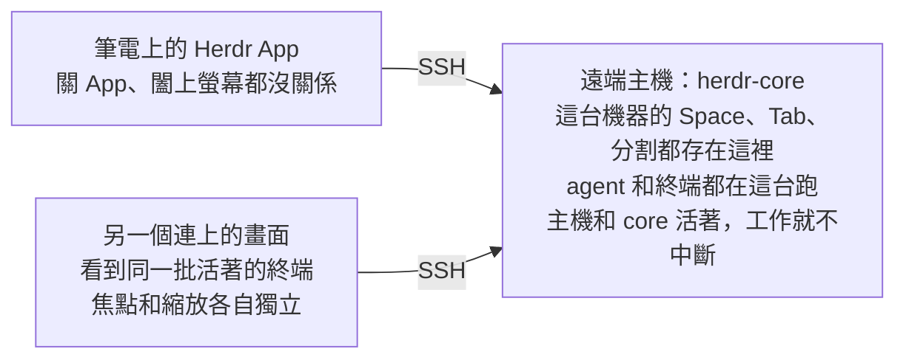

# Herdr App 圖文入門指南

> 配套文件：[[tmux 與 herdr 指令、快捷鍵對照表]]（指令、快捷鍵、從 tmux 過來的雷）、[[tmux + SSH 讓 claude 重新連接]]（AI/ReArt）
> 公司導入評估：[[建議：全公司統一採用 Herdr App 作為 AI agent 工作台]]（AI/）
> 撰文日期：2026-11-16。App 版本更新很快，本文版本號以撰文當時為準；本機實際裝的版本見對照表開頭。


## 先搞懂三兄弟：TUI、herdr-core、App

App 不是把 TUI 包成視窗，而是建在新 runtime herdr-core 上的另一套程式，2026-10-29 發表，目前還在 0.1.x。



> 在 TUI 開的 agent 不會出現在 App 裡，反之亦然；要換邊就得在那邊重開。

App 和 hc 都只是 herdr-core 的客戶端：關掉 App，終端照樣在 core 裡跑。TUI 則是另一個世界，有自己的 server。

|  | Herdr TUI | Herdr App | herdr-core（hc） |
| --- | --- | --- | --- |
| 是什麼 | 終端機程式＋自己的 server | 原生桌面 App，建在 core 上 | 無介面的 runtime |
| 撰文時版本 | 0.9.5 | 0.1.12 | 0.1.17 |
| Space / Tab / Pane | 有 | 有 | 無 |
| 關視窗 agent 繼續跑 | 是 | 是 | 是 |
| SSH 遠端機器 | 是 | 是 | 是 |
| agent 狀態來源 | 螢幕偵測＋官方整合 | 只認 OSC 7501 | 只認 OSC 7501 |
| 重開機後 | 支援的 agent 可續跑 | 同資料夾開新 shell，agent 不回來 | 同左 |
| 客製化 | 設定檔＋plugins | layouts、keys、panels、mods | 自己寫 client |
| 授權 | Apache-2.0 | Apache-2.0 | Apache-2.0 |

怎麼選：在終端機或 SSH 工作、需要重開機續跑、或 agent 不支援 OSC 7501 → TUI；要原生視窗、想讓 agent 改介面 → App；腳本或 agent 自己驅動 → core。已經在用 TUI，官方說法是不用急著換。（[Moshi 比較文](https://getmoshi.app/articles/herdr-core-vs-tui)）

## 安裝

一行指令就裝好，安裝程式會順便補上 herdr-core，不用另外裝。

```bash
# macOS / Linux
curl -fsSL https://releases.herdr.dev/app/install.sh | sh

# macOS 也可以用 Homebrew
brew install --cask herdr-app
```

| 平台 | 支援 | 備註 |
| --- | --- | --- |
| macOS | Apple Silicon | Intel Mac 要自己從原始碼編譯 |
| Linux | x86_64、ARM64 | 需要桌面環境和可用的 Vulkan 驅動 |
| Windows | x86_64 | core 用 named pipe，Unix 用 Unix socket |

裝完後的兩件事：

- 桌面版預設開啟遙測，每天回傳使用報告（不含終端文字、prompt、檔案內容）；不想要就到 Settings → Privacy 關掉。
- 官方版本會在背景自動更新，重開 App 後切換版本，而 core 會讓終端繼續活著。

（[官方下載頁](https://herdr.dev/download/) · [Falcão 的詳細評測](https://falcao.org/posts/herdr-desktop-finally-here/)）

## 核心概念：四層結構

記住四層就夠：機器裡開 Space，Space 裡開 Tab，Tab 裡切 Pane。跟 tmux 的 session / window / pane 很像，只是最外面多了「哪台機器」。



> Pane 可以分割、調大小、放大，拖曳可互換或並排；tab bar 的＋選單可開終端或已安裝的 agent。

實際用法：一個 repo 一個 Space，一個任務一個 Tab，agent 和 dev server 在同一個 Tab 裡切成兩個 Pane。常用的自訂指令可以寫進 `programs.json`，就會出現在＋選單裡。

## 側邊欄：一眼看出誰在等你

App 最實用的是左側的 agent 列表：Blocked 就是在等你，Done 是你不在時做完的。



> 狀態來自 agent 主動用 OSC 7501 回報；沒回報的 agent 照樣能跑，只是側邊欄看不到它的狀態。

- 側邊欄可以依 Space 分組，或把需要你的排在最上面；可以 pin 住 agent、折疊區塊。
- Tab 和 Space 本身也會顯示狀態，狀態變化時有音效和可點的 toast。
- `Ctrl+Shift+B` 開關側邊欄。

**OSC 7501 是關鍵**：herdr-core 不會去抓螢幕猜狀態，而是等程式自己用 OSC 7501 這個開放協定回報。所以：

- 舊版 agent 可能還不支援，先更新 Claude Code / Codex 等 CLI。
- **不要在 Pane 裡再包一層 tmux**，回報會傳不到 Herdr；agent 直接跑在 Herdr 的 Pane 裡。
- 回報分不出一輪對話的邊界，也偵測不到 `/new`。

## 什麼會活著、什麼會消失

關視窗沒事，關 Pane 或 Tab 才會殺掉程式；重開機後 agent 不會自動回來，這點和 TUI 不同。

| 你做了什麼 | 結果 |
| --- | --- |
| 關掉 App 視窗 | 終端繼續在 herdr-core 裡跑，重開 App 就看得到 |
| 筆電闔上（遠端機器的工作） | 只要遠端機器和它的 core 還在，就繼續跑 |
| 關掉 Pane 或 Tab | 裡面的終端會結束 |
| 重開機，或 core 當掉 | 程式停止；保留的 Pane 會在原資料夾開新 shell，agent 不會接回來 |
| App 自動更新 | 重開 App 後換版本，core 讓終端保持活著 |

重開機後要接回對話，就在新 shell 裡自己用 agent 的 resume 功能（例如 Claude Code 的 `--resume`）。

## 進階功能：遠端、Git、子 agent

### 遠端機器

在 Settings 或側邊欄用 SSH 加入一台機器（可直接選 `~/.ssh/config` 裡的 host），它的 Space 就會出現在該機器底下，終端在那台跑。



實用情境：agent 放在家裡的主機或 VPS 上跑，筆電闔上、出門也不中斷；回來打開 App 就接上。貼圖也會傳到遠端終端。

### Files、Changes、Worktrees

- **Files**：檔案樹，帶語法上色的唯讀預覽。
- **Changes**：變更檔案、diff、commit 訊息欄和 commit 按鈕。注意它執行的是 `git add -A` 再 `git commit`，不能挑檔案 stage。
- **Worktrees**：在介面裡建立、開啟、刪除 worktree，會排在 repo 底下；側邊欄顯示 branch、ahead/behind 和未 commit 的變更。很適合「一個 issue 一個 worktree、一個 agent」。

### 子 agent（sub-agent）

透過 `hc` 啟動的 worker 會排在父 agent 底下。沒有自己 Pane 的 worker 可以用「peek」疊在目前的 Tab 上看，想留下來就轉成 Tab。在輸出裡的終端位址上 Ctrl+點（macOS 是 Cmd+點）也會開 peek。

## 客製化：叫 agent 改 App

App 的整個介面都是磁碟上的檔案，官方主推的用法不是自己改設定，而是直接叫 agent 改。

### 設定檔在哪

全部在 `~/.config/herdr-app`，裡面的 `AGENTS.md` 會說明每個檔案的用途，agent 讀完就知道怎麼改。

| 檔案 / 概念 | 管什麼 |
| --- | --- |
| `keys.json` | 快捷鍵，可重綁，也可以讓某個鍵直接傳給終端程式 |
| `programs.json` | ＋選單裡的自訂指令 |
| Layouts | 視窗結構；內建 Herdr、終端為主、Herdr 98（Win98 風） |
| Mods | 面板、選單、對話框；用 JavaScript（QuickJS）描述原生 UI，改完即時重載 |
| Themes | 主題、字型、音效 |

預設的側邊欄和 tab bar 也是用同一套零件做的，所以你寫的 mod 能做到跟內建一樣的事。

### 官方建議的玩法：直接問

開一個 agent，叫它先讀官方 guide，然後用話說你要什麼。[官方 Guide](https://herdr.dev/guide/) 列的範例：

- 把 agent 分欄排成看板
- 每個 Tab 加一個計時器
- 把一台遠端主機加成 machine
- 幫某個 branch 開一個 reviewer agent
- 每個 issue 開一個 worktree
- 調主題、字型、音效
- 透過 ntfy 推播到手機
- 套用別人分享的 layout 或 mod（要找靈感可以逛 [Gallery](https://www.bitdoze.com/herdr-app-layouts-mods/)）

### 改壞了怎麼辦

- 改壞的設定會保留上一個可用版本並回報錯誤，不會整個掛掉。
- **官方附的 layout 和 mod 每次啟動都會被覆蓋**，要改就先複製一份再改。
- 給 agent 用的 CLI：`herdr-app --skill`、`herdr-app commands`、`herdr-app status`、`herdr-app shot`（截 PNG，讓 agent 看自己改的結果）。

## hc 指令速查

`hc` 是 herdr-core 的 CLI，給腳本和 agent 用；在 App 裡開的東西，也能從這裡控制。

| 指令 | 用途 |
| --- | --- |
| `hc run --bg --name web bun dev` | 在背景開一個任務並命名 |
| `hc run --keep` | 重開機後保留這個終端（開新 shell，不重跑任務） |
| `hc attach web` | 接上單一個終端（一次一個，沒有版面） |
| `hc send` | 送輸入給終端，會尊重 blocked 狀態 |
| `hc wait --children all` | 等所有子 agent 做完 |
| `ssh box hc connect` | 連到遠端的 core |
| `hc file edit` | 精確的遠端編輯；多處修改要嗎全成功、要嗎全失敗 |
| `hc schema` | 印出 OpenRPC API 文件 |
| `hc --skill` | 給 agent 讀的使用說明 |

其他選項：`--via` 可以接任何位元透明的指令（例如 Fly、Vercel sandbox），`--temp` 用在短命機器，`HC_SESSION` 可以分出另一組 core 和狀態（但不是安全邊界）。（[Moshi 比較文](https://getmoshi.app/articles/herdr-core-vs-tui) · [herdr-core 文件](https://herdr.dev/core/)）

## 限制與坑

App 才發表三週左右，當成 beta 看待比較安全。

- **還在早期**：凍結、CPU 用量、輸入法、剪貼簿、繪圖等問題都還在修。用中文輸入法的人要留意。
- **Mods 沒有沙箱**：它們能執行程式、讀寫檔案、連網，還能在已連線的機器上跑程式。別人的 mod 裝之前先看過。
- **core 沒有權限控制**：能碰到 socket 的人就能用你的帳號執行指令，沒有 API 密碼。協定也還標註 preview。
- **Mosh 沒有捲動紀錄**：Mosh 只同步可見畫面，要看歷史就用 SSH。TUI 把捲動紀錄存在 server，沒這問題。
- **遙測預設開啟**：Settings → Privacy 關掉。

### 從 TUI 轉過來的檢查清單

- [ ] 接受 TUI 裡跑著的 agent 不會跟過來，要在 App 裡重開
- [ ] 更新 agent CLI，確認它們會回報 OSC 7501
- [ ] 拿掉 Pane 裡的巢狀 tmux
- [ ] 接受重開機後 agent 不會自動繼續，要自己 resume
- [ ] 常從手機 SSH 看 agent，或要重開機續跑？那部分工作先留在 TUI

## 參考資料

- [官方 Guide](https://herdr.dev/guide/) · [下載](https://herdr.dev/download/) · [herdr-core](https://herdr.dev/core/) · [herdr-core 原始碼](https://github.com/herdrdev/herdr-core)
- [Falcão：Herdr Desktop 詳細評測](https://falcao.org/posts/herdr-desktop-finally-here/)
- [Moshi：TUI vs App vs herdr-core](https://getmoshi.app/articles/herdr-core-vs-tui)
- [Classmethod：App 與 TUI 實測對比](https://dev.classmethod.jp/en/articles/reona-herdr-app-herdr-core/)
- [Bitdoze：Layouts 與 Mods 介紹](https://www.bitdoze.com/herdr-app-layouts-mods/)
- 影片：[New HERDR Desktop App Is A Game Changer!（附章節筆記）](https://www.ai-automation-station.com/guides/herdr-desktop-app.html)

App 版本更新很快，細節請以官方 README 和 changelog 為準；實際指令與快捷鍵對照見 [[tmux 與 herdr 指令、快捷鍵對照表]]。
